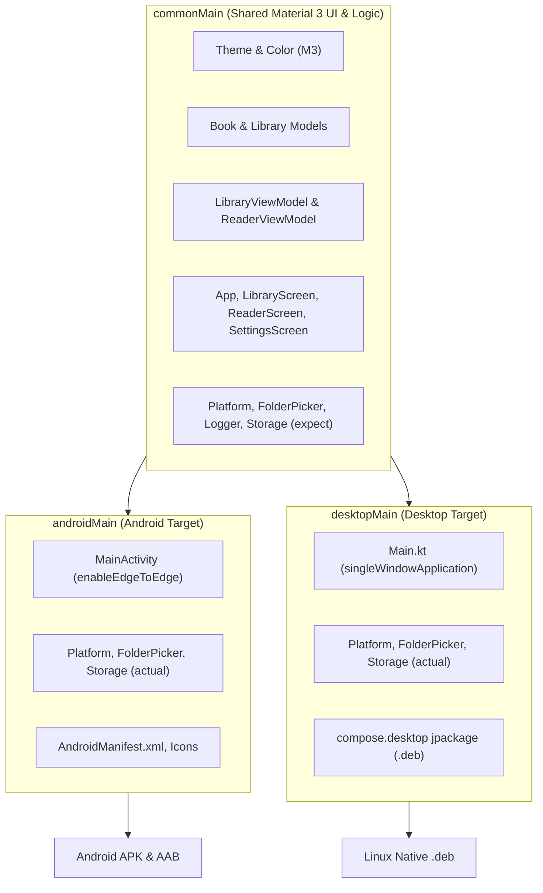

# LibreraReader Modernization & Multiplatform Migration Plan

## Executive Architecture Overview

This plan establishes a modern **Kotlin Multiplatform (KMP)** and **Compose Multiplatform (CMP)** architecture with **Material 3 (M3)** design system for LibreraReader, delivering:
1. **Unified Common UI (`commonMain`)**: Idiomatic Kotlin, Material 3 color system, typography, components, and reactive ViewModels.
2. **Android Target (`androidMain`)**: Edge-to-edge support (`enableEdgeToEdge`), dynamic color (Android 12+), and Android platform implementations.
3. **Desktop Target (`desktopMain`)**: Native Linux `.deb` packaging via `jpackage` with application metadata, shortcuts, icons, and desktop JVM platform implementations.
4. **Automated CI/CD**: Pull Request verification and automated GitHub Release publishing for Android APK/AAB and Linux `.deb` installers.

---

## 1. File Modification & Creation Inventory

### Build Configuration & Multiplatform Setup
| File | Action | Purpose |
|------|--------|---------|
| [settings.gradle.kts](file:///D:/ChadK/git/LibreraReader/settings.gradle.kts) | Modify | Activate `:composeApp` in project tree |
| [build.gradle.kts](file:///D:/ChadK/git/LibreraReader/build.gradle.kts) | Modify | Register root KMP/Compose plugins and convenience delegation tasks (`assembleDebug`, `packageDeb`) |
| [gradle/libs.versions.toml](file:///D:/ChadK/git/LibreraReader/gradle/libs.versions.toml) | Verify/Update | Align Kotlin, Compose Multiplatform, AGP, and Material 3 dependencies |
| `composeApp/build.gradle.kts` | Create | Configure `androidTarget` + `jvm("desktop")`, sourceSets, and `compose.desktop.nativeDistributions` for `.deb` |
| [gradle.properties](file:///D:/ChadK/git/LibreraReader/gradle.properties) | Modify | Ensure safe build fallbacks for signing keys and API tokens |
| [local.properties](file:///D:/ChadK/git/LibreraReader/local.properties) | Create | Local SDK path configuration |
| [gradlew.bat](file:///D:/ChadK/git/LibreraReader/gradlew.bat) | Create | Windows Gradle wrapper batch script |

### CommonMain (Shared Material 3 UI & Domain)
| File | Path | Description |
|------|------|-------------|
| `Color.kt` | `composeApp/src/commonMain/kotlin/mobi/librera5/theme/Color.kt` | Material 3 tonal palettes (Light, Dark, Sepia, AMOLED/E-ink) |
| `Type.kt` | `composeApp/src/commonMain/kotlin/mobi/librera5/theme/Type.kt` | Semantic typography scales |
| `Theme.kt` | `composeApp/src/commonMain/kotlin/mobi/librera5/theme/Theme.kt` | `LibreraTheme` with dynamic color hook and surface tinting |
| `Platform.kt` | `composeApp/src/commonMain/kotlin/mobi/librera5/platform/Platform.kt` | Multiplatform platform abstraction (`expect`) |
| `FolderPicker.kt` | `composeApp/src/commonMain/kotlin/mobi/librera5/platform/FolderPicker.kt` | Multiplatform file/folder selector (`expect`) |
| `Storage.kt` | `composeApp/src/commonMain/kotlin/mobi/librera5/platform/Storage.kt` | Key-value preferences storage (`expect`) |
| `AppLogger.kt` | `composeApp/src/commonMain/kotlin/mobi/librera5/platform/AppLogger.kt` | Cross-platform logger (`expect`) |
| `Book.kt` | `composeApp/src/commonMain/kotlin/mobi/librera5/model/Book.kt` | Book model with metadata, reading progress, and format |
| `LibraryViewModel.kt` | `composeApp/src/commonMain/kotlin/mobi/librera5/ui/viewmodel/LibraryViewModel.kt` | Search, filtering, shelves, sorting state |
| `ReaderViewModel.kt` | `composeApp/src/commonMain/kotlin/mobi/librera5/ui/viewmodel/ReaderViewModel.kt` | Page navigation, themes, font sizing, bookmarks |
| `Components.kt` | `composeApp/src/commonMain/kotlin/mobi/librera5/ui/components/Components.kt` | Accessible M3 components: 8dp grid, 48dp touch targets, semantic contentDescriptions |
| `LibraryScreen.kt` | `composeApp/src/commonMain/kotlin/mobi/librera5/ui/screens/LibraryScreen.kt` | Responsive book shelf grid/list, filter chips, search bar |
| `ReaderScreen.kt` | `composeApp/src/commonMain/kotlin/mobi/librera5/ui/screens/ReaderScreen.kt` | Modern reading surface, page progress, controls overlay |
| `SettingsScreen.kt` | `composeApp/src/commonMain/kotlin/mobi/librera5/ui/screens/SettingsScreen.kt` | Material 3 settings preferences, theme selector |
| `App.kt` | `composeApp/src/commonMain/kotlin/mobi/librera5/App.kt` | Root Scaffold with NavigationBar (Mobile) / NavigationRail (Desktop) |

### Android & Desktop Targets
| File | Path | Description |
|------|------|-------------|
| `MainActivity.kt` | `composeApp/src/androidMain/kotlin/mobi/librera5/MainActivity.kt` | `ComponentActivity` with `enableEdgeToEdge()` |
| `Platform.android.kt` | `composeApp/src/androidMain/kotlin/mobi/librera5/platform/Platform.android.kt` | Android `actual` with Android 12+ dynamic color |
| `FolderPicker.android.kt` | `composeApp/src/androidMain/kotlin/mobi/librera5/platform/FolderPicker.android.kt` | Android SAF file/folder picker actual |
| `Storage.android.kt` | `composeApp/src/androidMain/kotlin/mobi/librera5/platform/Storage.android.kt` | SharedPreferences actual |
| `AppLogger.android.kt` | `composeApp/src/androidMain/kotlin/mobi/librera5/platform/AppLogger.android.kt` | `android.util.Log` actual |
| `AndroidManifest.xml` | `composeApp/src/androidMain/AndroidManifest.xml` | Modern edge-to-edge application manifest |
| `Main.kt` | `composeApp/src/desktopMain/kotlin/mobi/librera5/Main.kt` | Desktop `singleWindowApplication` entry point |
| `Platform.desktop.kt` | `composeApp/src/desktopMain/kotlin/mobi/librera5/platform/Platform.desktop.kt` | Desktop JVM platform info actual |
| `FolderPicker.desktop.kt` | `composeApp/src/desktopMain/kotlin/mobi/librera5/platform/FolderPicker.desktop.kt` | Desktop Swing `JFileChooser` actual |
| `Storage.desktop.kt` | `composeApp/src/desktopMain/kotlin/mobi/librera5/platform/Storage.desktop.kt` | Java `Preferences` actual |
| `AppLogger.desktop.kt` | `composeApp/src/desktopMain/kotlin/mobi/librera5/platform/AppLogger.desktop.kt` | Console logger actual |
| `icon.png` | `composeApp/src/desktopMain/resources/icon.png` | Linux desktop icon for jpackage distribution |

### CI/CD Workflows
| File | Path | Description |
|------|------|-------------|
| `ci.yml` | `.github/workflows/ci.yml` | Validates PRs & pushes on `main` with `./gradlew assembleDebug` and `./gradlew packageDeb` |
| `release.yml` | `.github/workflows/release.yml` | Pushes on `v*` tags: builds signed Android APK/AAB, packages Linux `.deb`, and publishes GitHub Release |

---

## 2. Architectural Trade-offs & Platform Abstractions

1. **Clean Separation of Shared Logic vs Platform Hooks**:
   - Rather than tying UI directly to `android.content.Context` or `android.util.Log`, `commonMain` accesses pure Kotlin models and `expect`/`actual` services (`Platform`, `FolderPicker`, `Storage`, `AppLogger`).
2. **Adaptive Navigation**:
   - On Android (compact screens), navigation uses Material 3 `NavigationBar` at the bottom with edge-to-edge system insets.
   - On Desktop (expanded screens), navigation automatically adapts to a Material 3 `NavigationRail` on the left.
3. **Graceful Build Fallbacks**:
   - `build.gradle` and workflows gracefully fall back when GitHub Release secrets (`KEYSTORE_BASE64`, etc.) are not yet defined, allowing builds and CI checks to run without blocking.
